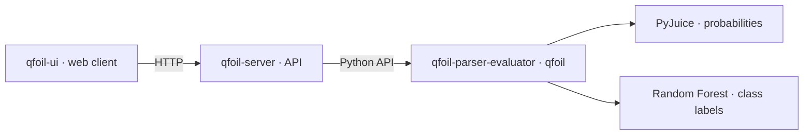

# QFOIL

Project overview and setup guide for the proof-of-concept prototype accompanying
*Semirings Meet Interpretability: A Quantitative Logic for Model Explanations*
(Pinto & Arenas).

QFOIL evaluates quantitative logic formulas over partial tuples and machine
learning models. This public repository contains all three components and
identifies the source versions used for the academic artifact.

## Components

| Directory | Role |
| --- | --- |
| [qfoil-parser-evaluator](qfoil-parser-evaluator/README.md) | QFOIL language, parser, evaluator and model backends; Python package `qfoil`. |
| [qfoil-server](qfoil-server/README.md) | HTTP API, request limits and lifecycle of one active model. |
| [qfoil-ui](qfoil-ui/README.md) | Web interface for formulas, evaluation settings, witnesses, models and test samples. |



The runtime can also be used directly from Python. The UI sends expressions to
the server; it renders server-generated LaTeX with KaTeX and does not interpret
QFOIL locally.

## Academic artifact: `article-v1.0.0`

This tag identifies the complete system in this public repository. Each
component was copied from its approved private main/master branch; private Git
history is not included. [artifact.json](artifact.json) records the source
commits, source trees and public import commits.

| Component | Source commit | Public import commit |
| --- | --- | --- |
| Parser/evaluator | `40cf56e` | `1cc4734` |
| Server | `2cbc1b7` | `4c21135` |
| UI | `efdc07e` | `97cef64` |

The server snapshot includes the isolated startup test correction. Its runtime
code is unchanged from the earlier component tag. Later README adaptations
are separate commits on top of these imports.

Package versions remain `0.1.0`; the artifact tag identifies the publication
snapshot. The earlier private component tags remain unchanged. Python
dependencies use the ranges declared by the components; this manifest pins
their source, not a complete environment.

## Run the system

Use Python 3.10 or later and a Node.js version supported by Vite 6 (18, 20,
or 22 and later), with npm. All source directories are included in this clone.
Optional model backends need additional dependencies.

### 1. Obtain the sources

Clone the public repository and select the publication tag:

```bash
git clone https://github.com/giulianodelagala/qfoil.git
cd qfoil
git checkout article-v1.0.0
```

The checkout contains `qfoil-parser-evaluator/`, `qfoil-server/` and `qfoil-ui/`.
There are no submodules or separate component clones. `git rev-parse HEAD`
identifies the public release commit; the private source commits in the
manifest document provenance and are not separate checkouts here.

### 2. Install and start the server

From `qfoil/`, create a shared Python environment and install the runtime first:

```bash
python -m venv .venv
source .venv/bin/activate
python -m pip install -e ./qfoil-parser-evaluator
python -m pip install -e ./qfoil-server
qfoil-server
```

The server listens on `http://127.0.0.1:8000`; API documentation is available at
`http://127.0.0.1:8000/docs`. It starts with no model loaded.

### 3. Start the UI

In a second terminal, from the cloned `qfoil/` root:

```bash
cd qfoil-ui
npm ci
npm run dev
```

Open the URL printed by Vite. Its `/api` proxy targets the server on port 8000.
The header should show **Connected**. With expression `SIZE(x) <= 2` and
bindings `{"x": [1, null, 0]}`, **Evaluate** returns `Value: 1`; **Render
formula** displays the formula. This check does not require a loaded model.

### 4. Use model backends

From the repository root, install both backend extras for Random Forest
in the shared Python environment:

```bash
python -m pip install -e "./qfoil-parser-evaluator[random_forest]"
python -m pip install -e "./qfoil-server[random_forest]"
```

For probabilistic circuits, use the `pyjuice` extra in both projects instead.
Follow the [runtime setup](qfoil-parser-evaluator/README.md)
for model artifacts and hardware requirements, and the
[server guide](qfoil-server/README.md) for
`QFOIL_MODEL_CATALOG`. Set the catalog before starting the server, then use the
UI's **Model** tab to load an entry.

The eight-feature MUX Random Forest uses
`S0, S1, D0, D1, D2, D3, N0, N1` and labels 0/1. With a complete binary tuple
bound to `x`, `FULL(x) * (VAL(x) == 1)` checks class 1. RF does not support
probability operators `EP`, `CEP`, `COND` or `VAL(x,c)`.

## Evaluation and validation

HTTP evaluation defaults to bounded heuristic search. An inconclusive result
does not prove absence of a witness. **Evaluation settings** can select
exhaustive execution, which uses the runtime's restricted exact enumeration;
both modes share a total work budget. See the
[HTTP contract](qfoil-server/API_CONTRACT.md)
and component READMEs for details.

Tests run separately in each component. After activating the shared Python
environment, install the full parser test dependencies and server test
dependencies from the repository root:

```bash
python -m pip install -e "./qfoil-parser-evaluator[dev,random_forest]"
python -m pip install -e "./qfoil-server[test]"
```

Run `python -m pytest tests/` from each Python component directory, and
`npm test` / `npm run build` from `qfoil-ui/`. Calling pytest through Python
selects the active environment's interpreter. The full parser suite imports
Torch and PyJuice during collection; CUDA tests skip when no GPU is available. The MUX RF artifact checks all 256 inputs against its truth table; those
inputs also train the forest, so the check is not held-out accuracy.

## Publishing later versions

Development remains in the private component repositories. To prepare another
public version, export approved commits into their respective directories,
review additions and removals, update `artifact.json`, and run the component
tests. Copy file snapshots without merging private branches or Git histories.
Record public-only documentation adjustments separately, then publish a new
tag after review. Existing publication tags stay fixed.

## Citation

If you use this software, please cite *Semirings Meet Interpretability:
A Quantitative Logic for Model Explanations* by Alexander Pinto and Marcelo
Arenas. [CITATION.md](CITATION.md) records this citation; publication
metadata will be added when available.

## Implementation

The implementation was developed with assistance from generative AI models.
