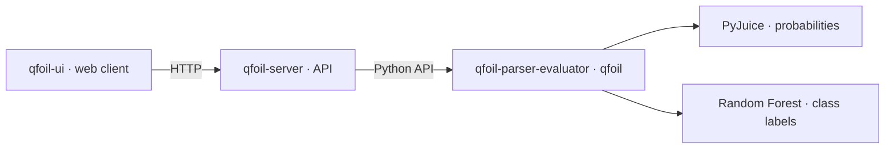

# QFOIL

Project overview and setup guide for the proof-of-concept prototype accompanying
*Semirings Meet Interpretability: A Quantitative Logic for Model Explanations*
(Pinto & Arenas).

QFOIL evaluates quantitative logic formulas over partial tuples and machine
learning models. You can use it directly from Python or through the web
interface and HTTP API.

## Components

| Directory | Role |
| --- | --- |
| [qfoil-parser-evaluator](qfoil-parser-evaluator/README.md) | QFOIL language, parser, evaluator and model backends; Python package `qfoil`. |
| [qfoil-server](qfoil-server/README.md) | HTTP API, request limits and lifecycle of one active model. |
| [qfoil-ui](qfoil-ui/README.md) | Web interface for formulas, evaluation settings, witnesses, models and test samples. |



The runtime can also be used directly from Python. The UI sends expressions to
the server; it renders server-generated LaTeX with KaTeX and does not interpret
QFOIL locally.

## Changes in article-v1.0.1

Non-strict tuple inclusion now uses `y <<= x`; the former `y <<< x` syntax
is rejected. Strict inclusion remains `y << x`, and the `SUBSETEQ` and
`subseteq` keyword aliases are unchanged. Update saved scripts and notebooks
to use `<<=`. The web client migrates expressions already stored in its
browser history automatically.

The parser, evaluator, witness search, Z3 translation and LaTeX renderer
use the new syntax. Component source commits and export exclusions are
recorded in [artifact.json](artifact.json). This update adds no models or
datasets.

## Run the system

Use Python 3.10 or later and a Node.js version supported by Vite 6 (18, 20,
or 22 and later), with npm. All source directories are included in this clone.
Optional model backends need additional dependencies.

### 1. Obtain the sources

Clone `main` for the current version:

```bash
git clone --branch main https://github.com/giulianodelagala/qfoil.git
cd qfoil
```

You can also download and extract the `main` ZIP from GitHub.
All three components are included in the same repository.

### 2. Install the Python packages

From `qfoil/`, create a shared Python environment and install the runtime first:

```bash
python -m venv .venv
source .venv/bin/activate
python -m pip install -e ./qfoil-parser-evaluator
python -m pip install -e ./qfoil-server
```

### 3. Configure model backends (optional)

For a first check with tuple operations and formula rendering, continue to
step 4. To query a trained model, configure a backend and catalog first.

From the repository root, install both backend extras for Random Forest
in the shared Python environment:

```bash
python -m pip install -e "./qfoil-parser-evaluator[random_forest]"
python -m pip install -e "./qfoil-server[random_forest]"
```

#### Configure the model catalog (CPU)

The server does not discover model directories automatically. Without
`QFOIL_MODEL_CATALOG`, the UI's **Model** tab has an empty catalog.
The clone includes two trained Random Forest models that run without CUDA.
From the repository root, with the shared Python environment activated,
create a local catalog with absolute paths:

```bash
python - <<'PY'
import json
from pathlib import Path

models = Path("qfoil-parser-evaluator/examples/models").resolve()
catalog = {
    name: {
        "backend": "random_forest",
        "path": str(models / name),
        "device": "cpu",
    }
    for name in ("mux_random_forest", "mnist_random_forest_3_vs_8")
}
Path("models.local.json").write_text(json.dumps(catalog, indent=2) + "\n")
PY
```

The generated paths refer to this clone, so regenerate the file if you move it.
Step 4 connects this catalog to the server.

#### Probabilistic circuits (CUDA)

For probabilistic circuits, install the `pyjuice` extra in both projects:

```bash
python -m pip install -e "./qfoil-parser-evaluator[pyjuice]"
python -m pip install -e "./qfoil-server[pyjuice]"
```

Add a catalog entry with `"backend": "pyjuice"`, an absolute `"path"` to a
bundled PC directory such as
`qfoil-parser-evaluator/examples/models/mnist_binary_small_3_vs_8`, and
`"device": "cuda:0"`. Save the catalog as `models.local.json` and continue
to step 4. PyJuice circuit compilation requires CUDA in the version used by this
project. See the [runtime setup](qfoil-parser-evaluator/README.md) and
[server guide](qfoil-server/README.md) for backend details.

### 4. Start the server

From the repository root, activate the shared environment. If you created
`models.local.json` in step 3, set its path in this same terminal before
starting the server:

```bash
source .venv/bin/activate
# Optional: include this line only if you configured a model catalog.
export QFOIL_MODEL_CATALOG="$PWD/models.local.json"
qfoil-server
```

For a check without models, omit the `export` line. The server listens on
`http://127.0.0.1:8000`; API documentation is available at
`http://127.0.0.1:8000/docs`. It starts with no model loaded, even when a
catalog is configured. The catalog lists models available for loading later.

After changing the catalog, stop the server with Ctrl+C and repeat this step.

### 5. Start the UI

In a second terminal, from the cloned `qfoil/` root:

```bash
cd qfoil-ui
npm ci
npm run dev
```

Open the URL printed by Vite. Its `/api` proxy targets the server on port 8000.
The header should show **Connected**. With expression `SIZE(x) <= 2` and
bindings `{"x": [1, null, 0]}`, **Evaluate** returns `Value: 1`; **Render
formula** displays the formula. This check does not require a loaded model.

### 6. Load and query a model (optional)

Refresh the UI, open **Model**, select `mux_random_forest`, and click **Load**.
The server starts with no active model even when the catalog is configured.
Only one model can be active; click **Unload** before loading another.

With MUX loaded, evaluate `FULL(x) * (VAL(x) == 1)` with bindings
`{"x": [0, 0, 1, 0, 0, 0, 0, 0]}`. The expected value is `1`.
For `mnist_random_forest_3_vs_8`, click **Random sample** in the **Test dataset**
section of **Model**, then **Copy sample**. In **Playground**, paste that array
as the value of `x` in the bindings and evaluate `VAL(x)`.
That model expects 196 features and returns labels 3 or 8.

The same lifecycle is available directly over HTTP (unload a model already
loaded through the UI before running the POST):

```bash
curl http://127.0.0.1:8000/v1/models
curl -X POST http://127.0.0.1:8000/v1/models/mux_random_forest/load
curl http://127.0.0.1:8000/v1/models/current
curl -X POST http://127.0.0.1:8000/v1/expressions/evaluate \
  -H 'Content-Type: application/json' \
  -d '{"expression":"FULL(x) * (VAL(x) == 1)","bindings":{"x":[0,0,1,0,0,0,0,0]}}'
curl -X DELETE http://127.0.0.1:8000/v1/models/current
```

The eight-feature MUX Random Forest uses
`S0, S1, D0, D1, D2, D3, N0, N1` and labels 0/1. With a complete binary tuple
bound to `x`, `FULL(x) * (VAL(x) == 1)` checks class 1. RF does not support
probability operators `EP`, `CEP`, `COND` or `VAL(x,c)`.

## Evaluation settings

HTTP evaluation defaults to bounded heuristic search. An inconclusive result
does not prove absence of a witness. **Evaluation settings** can select
exhaustive execution, which uses the runtime's restricted exact enumeration;
both modes share a total work budget. See the
[HTTP contract](qfoil-server/API_CONTRACT.md)
and component READMEs for details.

## Citation

If you use this software, please cite *Semirings Meet Interpretability:
A Quantitative Logic for Model Explanations* by Alexander Pinto and Marcelo
Arenas. See [CITATION.md](CITATION.md) for citation details.

## Implementation

The implementation was developed with assistance from generative AI models.

## License

QFOIL's original source code is licensed under the Apache License, Version 2.0.
See [LICENSE](LICENSE) and [NOTICE](NOTICE). This includes the MUX generators,
oracles, and tests; MUX cases can be regenerated using the supplied code.

Third-party software, datasets (including MNIST), and pretrained models retain
their respective licenses and terms; they are not relicensed by this notice.
