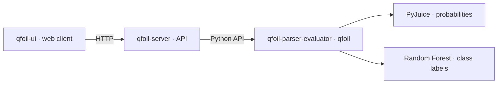

# QFOIL

Project overview and setup guide for the proof-of-concept prototype accompanying
*Semirings Meet Interpretability: A Quantitative Logic for Model Explanations*
(Pinto & Arenas).

QFOIL evaluates quantitative logic formulas over partial tuples and machine
learning models. This repository connects the three components and identifies
the source versions used for the academic artifact.

## Components

| Repository | Role |
| --- | --- |
| [qfoil-parser-evaluator](https://github.com/giulianodelagala/qfoil-parser-evaluator) | QFOIL language, parser, evaluator and model backends; Python package `qfoil`. |
| [qfoil-server](https://github.com/giulianodelagala/qfoil-server) | HTTP API, request limits and lifecycle of one active model. |
| [qfoil-ui](https://github.com/giulianodelagala/qfoil-ui) | Web interface for formulas, evaluation settings, witnesses, models and test samples. |



The runtime can also be used directly from Python. The UI sends expressions to
the server; it renders server-generated LaTeX with KaTeX and does not interpret
QFOIL locally.

## Academic artifact: `article-v1.0.0`

The same tag identifies a coordinated snapshot in each component. The source
commits are recorded in [artifact.json](artifact.json).

| Component | Tagged source | Commit |
| --- | --- | --- |
| Parser/evaluator | [article-v1.0.0](https://github.com/giulianodelagala/qfoil-parser-evaluator/tree/article-v1.0.0) | `7480462a61878725463c9bff84e46b1bf113fd7c` |
| Server | [article-v1.0.0](https://github.com/giulianodelagala/qfoil-server/tree/article-v1.0.0) | `5bf03063ed52dccec6cd79fde59a6472f1f953b7` |
| UI | [article-v1.0.0](https://github.com/giulianodelagala/qfoil-ui/tree/article-v1.0.0) | `0345c055444b27115cb2d8171a688b631b55517e` |

Package versions remain `0.1.0`; the artifact tag identifies the publication
snapshot. Later documentation changes on the default branches do not change
these tagged commits. Python dependencies use the ranges declared by the
components; this manifest pins their source, not a complete environment.

## Run the system

Use Python 3.10 or later and a Node.js version supported by Vite 6 (18, 20,
or 22 and later), with npm. Git access to the component repositories is required.
Optional model backends need additional dependencies.

### 1. Obtain the sources

Clone this overview repository and the three components as sibling directories:

```bash
git clone https://github.com/giulianodelagala/qfoil.git
cd qfoil
git clone --branch article-v1.0.0 --single-branch https://github.com/giulianodelagala/qfoil-parser-evaluator.git ../qfoil-parser-evaluator
git clone --branch article-v1.0.0 --single-branch https://github.com/giulianodelagala/qfoil-server.git ../qfoil-server
git clone --branch article-v1.0.0 --single-branch https://github.com/giulianodelagala/qfoil-ui.git ../qfoil-ui
```

The component checkouts are detached at the artifact tags. To confirm the
sources, compare `git rev-parse HEAD` in each checkout with the table above.

### 2. Install and start the server

From `qfoil/`, create a shared Python environment and install the runtime first:

```bash
python -m venv .venv
source .venv/bin/activate
python -m pip install -e ../qfoil-parser-evaluator
python -m pip install -e ../qfoil-server
qfoil-server
```

The server listens on `http://127.0.0.1:8000`; API documentation is available at
`http://127.0.0.1:8000/docs`. It starts with no model loaded.

### 3. Start the UI

In a second terminal, from the sibling `qfoil-ui/` directory:

```bash
npm ci
npm run dev
```

Open the URL printed by Vite. Its `/api` proxy targets the server on port 8000.
The header should show **Connected**. With expression `SIZE(x) <= 2` and
bindings `{"x": [1, null, 0]}`, **Evaluate** returns `Value: 1`; **Render
formula** displays the formula. This check does not require a loaded model.

### 4. Use model backends

For Random Forest, install both backend extras in the Python environment:

```bash
python -m pip install -e "../qfoil-parser-evaluator[random_forest]"
python -m pip install -e "../qfoil-server[random_forest]"
```

For probabilistic circuits, use the `pyjuice` extra in both projects instead.
Follow the [runtime setup](https://github.com/giulianodelagala/qfoil-parser-evaluator#readme)
for model artifacts and hardware requirements, and the
[server guide](https://github.com/giulianodelagala/qfoil-server#readme) for
`QFOIL_MODEL_CATALOG`. Set the catalog before starting the server, then use the
UI's **Model** tab to load an entry.

The eight-feature MUX Random Forest uses
`S0, S1, D0, D1, D2, D3, N0, N1` and labels 0/1. With a complete binary tuple
bound to `x`, `FULL(x) * (VAL(x) == 1)` checks class 1. RF does not support
probability operators `EP`, `CEP`, `COND` or `VAL(x,c)`.

## Evaluation and validation

HTTP evaluation defaults to bounded heuristic search. An inconclusive result
does not prove absence of a witness. **Evaluation settings** can select
exhaustive execution, which uses the runtime's restricted exact enumeration;
both modes share a total work budget. See the
[HTTP contract](https://github.com/giulianodelagala/qfoil-server/blob/5bf03063ed52dccec6cd79fde59a6472f1f953b7/API_CONTRACT.md)
and component READMEs for details.

Tests are maintained in each component. Follow their documented setup before
running `pytest` in the Python repositories and `npm test` / `npm run build`
in the UI. PyJuice integration tests require their optional dependencies and
CUDA. The MUX RF artifact checks all 256 inputs against its truth table; those
inputs also train the forest, so the check is not held-out accuracy.

## Citation

If you use this software, please cite *Semirings Meet Interpretability:
A Quantitative Logic for Model Explanations* by Alexander Pinto and Marcelo
Arenas. [CITATION.md](CITATION.md) records this citation; publication
metadata will be added when available.

## Implementation

The implementation was developed with assistance from generative AI models.
